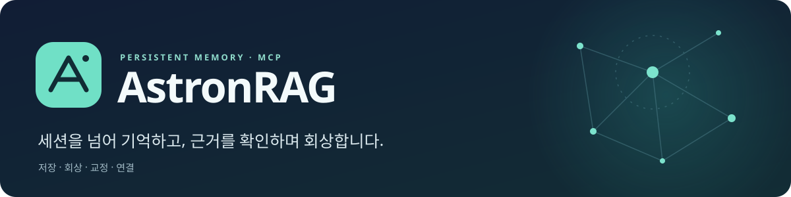
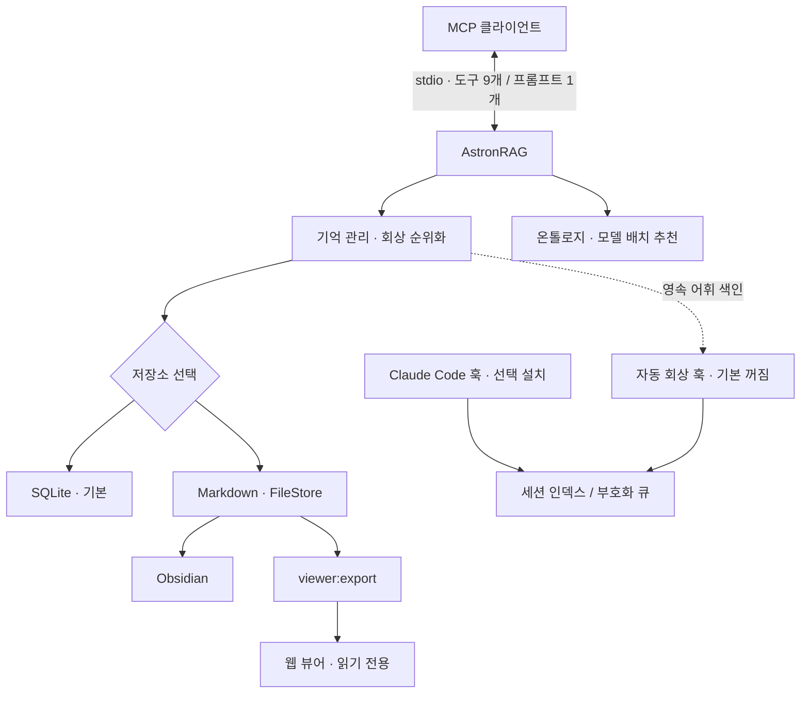
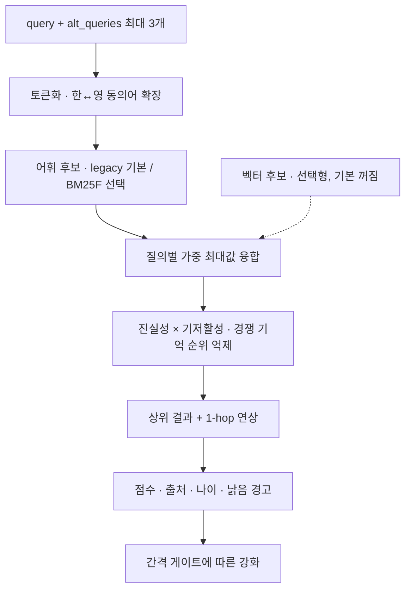
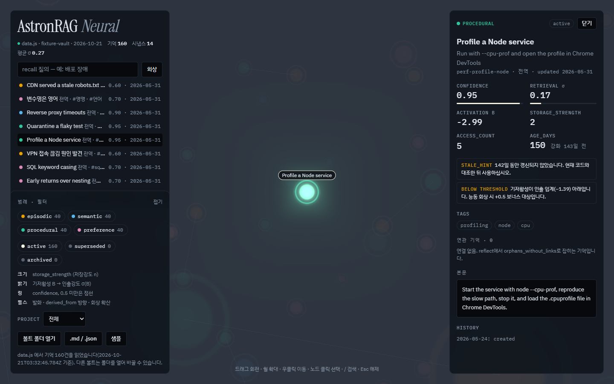
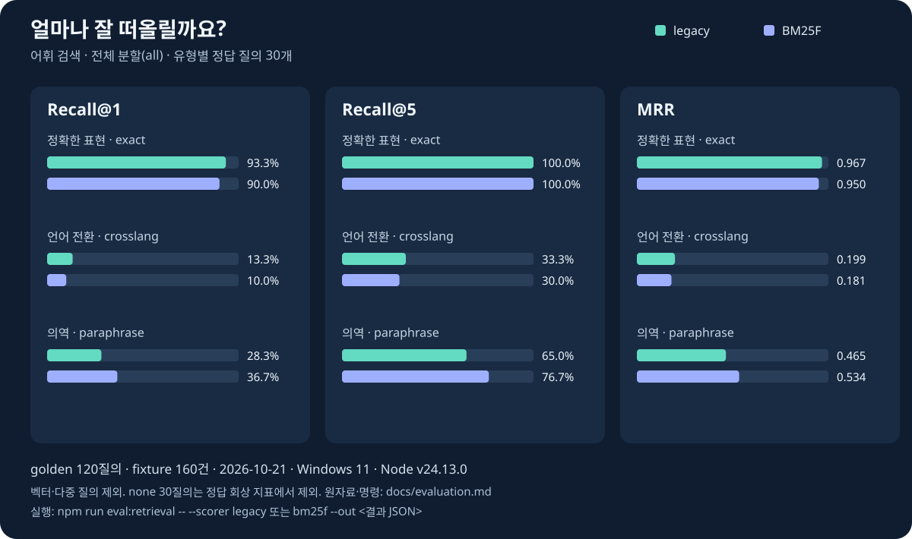

<p align="center">
	
</p>

<p align="center">
	
	
	
	
</p>

**AI가 세션을 넘어 기억을 저장·회상·교정하고, 출처와 연결 관계를 함께 확인하는 MCP 서버입니다.**

<table>
	<tr>
		<td><strong>🧠 오래 가는 기억</strong><br>사건·지식·절차·선호를 구분하고 진실성과 인출강도를 분리합니다.</td>
		<td><strong>🔎 표현을 넘는 회상</strong><br>한↔영 동의어, 다중 질의, 활성도와 연상 링크를 함께 씁니다.</td>
		<td><strong>🛡️ 확인 가능한 교정</strong><br>출처·검토일·구본을 보존하고 망각은 보관 처리합니다.</td>
		<td><strong>🌌 연결을 보는 뷰어</strong><br>Markdown 볼트의 목록·상세·관계를 읽기 전용으로 탐색합니다.</td>
	</tr>
</table>

기본 저장소는 **SQLite**이며, `ASTRONRAG_STORE=file`로 **Obsidian 호환 Markdown 볼트**를 선택할 수 있습니다. 임베딩과 자동 회상 훅은 **기본 꺼짐**입니다.

## 목차

[구조](#구조) · [회상 흐름](#회상-흐름) · [웹 뷰어](#웹-뷰어) · [회상 품질](#회상-품질) · [빠른 시작](#빠른-시작) · [제공 도구](#제공-도구) · [설정](#설정) · [운영 안내](#운영-안내)

## 구조



SQLite와 Markdown은 저장소 선택지입니다. **뷰어 내보내기는 Markdown 파일을 읽으므로**, SQLite의 기억은 먼저 [Markdown으로 내보내야](docs/operations.md#sqlite에서-markdown으로-내보내기) 합니다.

## 회상 흐름



- **동의어 24개 그룹**과 조사·접두 흡수로 한↔영 혼용을 보완합니다. 팀 용어는 설정으로 추가합니다.
- `alt_queries`는 원 질의와 다른 표현을 함께 검색합니다. 원 질의 가중치는 1, 변형은 기본 0.7이며 같은 기억은 한 호출에서 한 번만 강화됩니다.
- `confidence`는 진실성, `storage_strength`는 저장강도입니다. 인출강도는 빈도와 최근성을 바탕으로 질의 때 계산합니다.
- `stale_hint`와 `review_after`는 현재 자료와 대조할 시점을 알립니다. 오래된 기억을 현재 사실로 단정하지 않습니다.

수식·강화·공고화의 계약은 [기억 모델과 검색](docs/memory-guide.md)에 있습니다. 설계 원칙은 [기억 이론 리포트](docs/memory-model-report.md), 검토 자료는 [별도 검토 문서](docs/native-parity-audit.md)에서 확인할 수 있습니다. 현재 동작의 기준은 코드와 이 안내입니다.

## 웹 뷰어

<p align="center">
	
</p>

**실제 화면 · 공개 픽스처만 사용.** 목록 검색, type·status·project 필터, 본문과 위키링크·대체·파생 관계를 탐색합니다. 뷰어는 고정 다크 테마입니다.

```bash
npm run viewer:export
```

Markdown 볼트의 `memories/`·`archive/`를 `viewer/data.js`로 내보낸 뒤 [viewer/index.html](viewer/index.html)을 브라우저로 엽니다. 데이터 파일이 없으면 **볼트 폴더 열기**를 사용할 수 있습니다. 3D 장면과 글꼴은 CDN 연결이 필요하며 목록·상세는 오프라인에서도 동작합니다. 내보낸 파일에는 기억 원문이 담기므로 공유 전에 확인하십시오. [자세한 사용법](docs/operations.md#웹-뷰어)

## 회상 품질

<p align="center">
	
</p>

**2026-10-21 실행 · Windows 11 (10.0.26200), Node v24.13.0 · `eval/golden.jsonl` 120질의 · `eval/fixture-vault` 기억 160건.** 실행 명령은 `npm run eval:retrieval -- --scorer legacy --out ./eval-legacy.json` 및 `npm run eval:retrieval -- --scorer bm25f --out ./eval-bm25f.json`입니다. 그래프는 정답이 있는 각 30질의의 `all` 분할을 사용하며 백분율은 소수 첫째 자리, MRR은 소수 셋째 자리로 반올림합니다.

정확한 표현에 비해 언어 전환·의역 회상은 약합니다. 이 픽스처 결과를 일반적인 정확도나 성능 보장으로 해석하지 않습니다. 기본 점수 방식은 `legacy`이며 BM25F는 선택 설정입니다. 벡터 계층과 자동 회상 훅은 [전환 판단 기준](docs/evaluation.md#전환-판단-기준) 미충족으로 기본 꺼짐을 유지합니다. **벡터 결과는 이 차트에 포함하지 않았습니다.** [원자료·측정 조건·한계](docs/evaluation.md)

## 빠른 시작

Node.js **`^22.13.0 || >=23.4.0`**와 npm이 필요합니다. 이 저장소 루트에서 실행합니다.

```bash
npm ci
npm run build
npm start
```

`npm start`는 **stdio MCP 서버**를 실행합니다. MCP 클라이언트가 이 프로세스와 통신합니다.

이 저장소를 지원하는 클라이언트로 열면 [.mcp.json](.mcp.json)의 `node ./dist/index.js` 설정을 사용할 수 있습니다. 다른 작업 폴더에서는 실행 파일의 **절대 경로**를 지정합니다.

```json
{
	"mcpServers": {
		"astronrag": {
			"command": "node",
			"args": ["<설치 경로>/dist/index.js"]
		}
	}
}
```

<details>
<summary>Claude Code 등록과 회상 트리거</summary>

`<설치 경로>`를 실제 설치 위치로 바꿉니다.

```bash
claude mcp add --scope user astronrag -- node "<설치 경로>/dist/index.js"
npm run setup:hook -- --dry-run
npm run setup:hook
```

`setup:hook`은 로컬 Claude 설정에 SessionStart·UserPromptSubmit·Stop 훅을 설치합니다. 적용 전 미리보기를 확인하십시오. MCP 도구 호출은 모델이 선택하므로, 서버 instructions·세션 훅·네이티브 메모리 브리지로 기억의 존재를 알려 줍니다. **훅 설치와 자동 회상 활성화는 별개**입니다. [설치·제거·빈 볼트·훅 설정](docs/recall-triggers.md)

설치 후 Claude를 재시작하면 세 훅이 같은 `session_id`의 세션별 마커로 상태를 공유합니다. 빈 id는 추적하지 않으며, 마커가 없는 프롬프트에서도 활성화된 자동 회상은 동작할 수 있습니다(`scripts/setup-hook.mjs`의 `buildCommands`·`results`, `scripts/session-guard.mjs`의 `markerPath`·`readMarker`·`autoRecall`).

</details>

<details>
<summary>Markdown 볼트가 이미 있거나 Obsidian을 함께 쓴다면</summary>

기본 SQLite 서버가 Markdown 기억을 발견하면 이관을 요구할 수 있습니다. 운영 MCP를 멈추고 [이관·백업 절차](docs/operations.md#markdown에서-sqlite로-이관)를 따르거나, 클라이언트의 서버 환경에 `ASTRONRAG_STORE=file`을 지정하십시오. 네이티브 memory 디렉터리를 볼트로 직접 지정하지 않습니다.

```json
{
	"mcpServers": {
		"astronrag": {
			"command": "node",
			"args": ["<설치 경로>/dist/index.js"],
			"env": {
				"ASTRONRAG_STORE": "file",
				"ASTRONRAG_VAULT": "./vault",
				"ASTRONRAG_PROJECT": "my-app"
			}
		}
	}
}
```

`recall`·`list_memories`는 지정 프로젝트와 전역 기억을 조회합니다. **`remember`는 `project` 생략 시 전역 저장**이므로 프로젝트 전용 사실에는 값을 명시합니다. [프로젝트 스코핑](docs/configuration.md#프로젝트-스코핑)

</details>

## 제공 도구

**항상 등록되는 도구 9개**와 **프롬프트 1개**를 제공합니다. 온톨로지 로드 실패 시에도 `recommend`는 등록되며 호출 결과로 오류를 돌려줍니다.

| 도구 | 역할 | 주요 입력 |
|---|---|---|
| `remember` | 새 기억 저장, 중복·모순 후보 안내 | `title`, `content`, `type` |
| `recall` | 키워드·변형 질의로 회상 | `query`, 선택 `alt_queries`·`limit`·`project` |
| `read_memory` | 기억 전문 읽기 | `id` 또는 슬러그 |
| `revise` | 기억 교정·재확인 | `id`, `reason` |
| `forget` | 삭제 대신 보관 | `id`, `reason` |
| `link` | 기억 사이 양방향 연결 | `source`, `target` |
| `reflect` | 약화·중복·깨진 링크·공고화 후보 점검 | 없음 |
| `list_memories` | 유형·상태·프로젝트별 목록 | 선택 `type`·`status`·`project` |
| `recommend` | 온톨로지 기반 모델·추론 강도 배치 추천 | `description`, `role`, 선택 `platform` |

`consolidate`는 도구가 아닌 **정리 프롬프트**입니다. Claude Code에서는 `/mcp__astronrag__consolidate`로 불러 후보 비교·교정·연결·재확인 절차를 읽습니다. 자동 병합이나 삭제는 하지 않습니다. [전체 매개변수와 응답 필드](docs/tools.md)

## 설정

서버 환경은 MCP 등록의 `env`에 지정합니다. **훅 환경은 별도 프로세스에 전달**해야 합니다.

| 변수 | 기본값 | 용도 |
|---|---|---|
| `ASTRONRAG_STORE` | `sqlite` | `file`로 Markdown 선택 |
| `ASTRONRAG_VAULT` | `<저장소>/vault` | 저장소 루트 |
| `ASTRONRAG_SQLITE_PATH` | `<볼트>/.bbm/store.sqlite` | SQLite DB 경로 |
| `ASTRONRAG_PROJECT` | 설정 없음 | 조회 기본 스코프 |
| `ASTRONRAG_SCORER` | `legacy` | `bm25f` 선택 가능 |
| `ASTRONRAG_SYNONYMS` | 추가 없음 | 팀 용어 동의어 확장 |
| `ASTRONRAG_VECTOR` | 꺼짐 | `1`일 때만 벡터 모듈 로드 |
| `ASTRONRAG_AUTO_RECALL` | 꺼짐 | 훅 환경의 `1`일 때만 자동 회상 |

[전체 환경변수·기본값·숫자 파싱](docs/configuration.md) · [회상 트리거·자동 회상](docs/recall-triggers.md)

## 운영 안내

<details>
<summary>교정 복구·직접 편집·동시 사용·계측·시험</summary>

- **기억 안전성:** `revise`는 본문 교정 전 구본을 최근 3세대 보관합니다. `forget`은 보관 처리합니다. 중요한 저장소는 별도 백업합니다.
- **직접 편집:** Markdown 저장소에서는 원문을 편집할 수 있습니다. 알려지지 않은 frontmatter 키는 다음 쓰기에 보존되지 않으며 `MEMORY.md`는 자동 생성물입니다.
- **동시 사용:** SQLite는 트랜잭션과 재시도를 사용합니다. 파일 저장소는 원자적 쓰기와 배타적 생성을 사용하지만 모든 경합을 제거하는 잠금은 아닙니다.
- **계측:** 도구 사용 이벤트는 기본적으로 질의·본문·제목을 남기지 않습니다. 강화 실패 이벤트 `reinforcement_unapplied`에는 기억 slug(제목에서 만든 값)와 원문 오류 메시지가 남습니다(`src/store.ts`의 `MemoryService.reinforce`의 강화 실패 분기, `src/vault.ts`의 `Vault.makeSlug`). 조회가 간격 게이트를 통과하면 강화 쓰기가 발생할 수 있습니다.
- **시험:** `npm test`는 임시 저장소와 실제 stdio 서버를 사용합니다. 개별 시험과 이관 명령은 [운영 문서](docs/operations.md)에 있습니다.

</details>

문서 길잡이: [운영·이관](docs/operations.md) · [기억 모델](docs/memory-guide.md) · [도구](docs/tools.md) · [평가](docs/evaluation.md)
